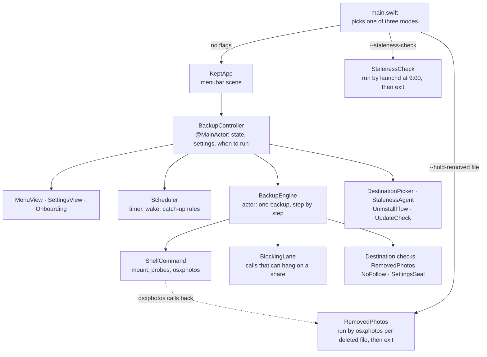

# How Kept is put together

Kept is one SwiftUI app, `app/Sources/Kept`. There are two ways to build it from the same files: the Xcode project, `app/Kept.xcodeproj`, for working on it, and Swift Package Manager wrapped by `app/build.sh`, which makes every installed and released copy. CI builds both. The app decides when to back up and explains what happened. [osxphotos](https://github.com/RhetTbull/osxphotos), running on a Python bundled inside the app, does the copying.

## The three modes

`main.swift` picks before any UI exists:

- **The menubar app**, the normal case.
- **`--staleness-check`**, which launchd runs daily from a LaunchAgent (`StalenessAgent`). It reads the history, may post "Backups have stopped", and exits. It must never become the app, or the watchdog would reopen an app the user quit.
- **`--hold-removed <file>`**, which osxphotos runs for each file it would delete. It moves the file into `Removed from Photos` instead, and exits. It only acts when a running Kept backup started it (`ProcessAncestry`).

## Who owns what

| Piece | Isolation | Owns |
|---|---|---|
| `BackupController` | main actor, `@Observable` | What the panel and Settings show, the preferences, and the decisions: retries, the three-tries-per-slot cap, no unattended backups on battery |
| `Scheduler` | main actor | The timer, the wake observer, and catch-up's rules (`fireCatchUpIfMissed`) |
| `BackupEngine` | actor | One backup: lock, library access, the share, expiry, free space, osxphotos with a stall watchdog. Takes its timings, interpreter and command runner as parameters so tests can drive it |
| `DestinationPicker` | main actor | The folder picker and the alerts that refuse or warn |
| `StalenessAgent` | — | The daily check's LaunchAgent and the "hasn't run" warnings |
| `UninstallFlow`, `Uninstall` | main actor, — | Remove Kept: the dialogs, then the plan of what's removed |
| `UpdateCheck` | — | Asking GitHub for the latest release, once a day |
| `ReviewTools`, `StatePreview` | main actor | Forced states for reviewing copy. Debug and local builds only (`KEPT_REVIEW_TOOLS`) |
| `FailureCopy`, `RunFormatting` | — | The panel's and the notifications' sentences about backups and failures. Alerts live with their flows |

## Rules that hold everywhere

- **Nothing blocks the cooperative pool.** Child processes go through `ShellCommand`, which drains both pipes on threads of their own and SIGKILLs on timeout. Calls that can hang on a share that stopped answering (`statfs`, existence checks, writes into the backup folder) go through a `BlockingLane`: their own thread, one at a time, with a timeout.
- **Stop reaches every step.** Each child the engine starts registers with a `StopSignal`, which kills it when the user stops the backup.
- **The backup folder is treated as hostile.** Anyone who can write to the share can plant links in it. `RemovedPhotos` and `NoFollow` move and delete through open folder descriptors and never follow a link. The saved folder setting is sealed with a key in the keychain (`SettingsSeal`, `DestinationStore`), and the disk or share is checked against the one chosen before every backup (`Destination.volumeMismatch`).
- **Children get a fixed environment** (`ChildEnvironment`), and Python runs isolated (`-I -B`), because they inherit Kept's Full Disk Access. Before each backup the engine checks the app's own signature (`AppSeal`), since Python would run an edited `.py` file without complaint.
- **A backup that couldn't copy files isn't green.** osxphotos exits 0 even when files failed, so the engine records the error count. Such a run is still `.success`, which keeps the schedule and the daily check honest about a backup having run, but `RunRecord.isPartial` keeps it from ever showing as a green tick. osxphotos' missing count is deliberately ignored: it lumps shared items, whose originals Photos never keeps on the Mac, in with the library's own, so it's high in any library with shared albums. The README's Limitations and the welcome screen cover Optimize Mac Storage instead.
- **History belongs to a backup folder.** Each run records the folder's `Destination.id`, and everything that measures protection (the panel, catch-up, retries, the daily check) reads only the current folder's runs. A newly chosen folder has none until a backup there finishes. Runs from before ids existed have none, and belong to the folder chosen before then, which has none either.
- **State is never kept in the backup folder.** The mirror moves aside anything osxphotos didn't put there.

## Where state lives

| Where | What |
|---|---|
| `~/Library/Application Support/Kept/` | `export.db` (the backup index; lose it and the next backup copies everything again), `runs.json` (history, each run naming its folder), `report.csv`, `.backup.pid` (the lock) |
| `~/Library/Logs/Kept/` | One log per backup, stall samples, `access-test.log` |
| Preferences, `com.chipcressman.Kept` | Settings, the sealed backup folder, setup state |
| Keychain, `com.chipcressman.Kept.settings-seal` | The seal key: the data-protection keychain with a provisioning profile, the login keychain without |
| `~/Library/LaunchAgents/com.chipcressman.Kept.staleness.plist` | The daily check |

## Tests

`app/Tests/KeptTests` never touches real state: preferences go to scratch suites, files to temporary folders, keychain items to their own service name. The engine tests drive the reconnect with scripted commands and the export with small shell scripts standing in for osxphotos. `ExportArgumentsTests` runs Kept's real arguments through the bundled osxphotos; CI points it at the app it just built.
