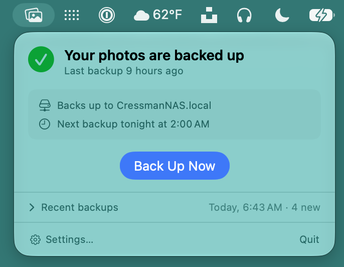

# Kept

[](https://github.com/cressmancm/KeptApp/actions/workflows/tests.yml)

**A Mac app that backs up your Apple Photos library to a drive you own. Free and open source.**

<p align="center">
  
</p>

<p align="center">More of setup, settings, and notifications in the <a href="docs/screenshots/README.md">screenshots</a>.</p>

## How it works

iCloud keeps your Apple Photos library synced, but it all depends on one account. Kept makes a second copy on a drive you own, like a NAS, an external drive, or another disk. It runs from your menu bar and backs up on a schedule.

1. **Set it up.** Open Kept, allow access to your Photos library, and choose a backup folder.
2. **Pick a schedule.** Nightly, weekly, or manual.
3. **Let it run.** At the scheduled time, Kept checks your whole library and copies only what's changed. It tells you if something needs your attention.

## Good to know

- Kept only backs up photos stored on your Mac, not ones that are only in iCloud. In Apple Photos, go to Settings → iCloud and turn on **Download Originals to this Mac**.
- If your Mac is asleep, offline, or on battery at backup time, Kept backs up as soon as it can.
- Your backup is plain photos and videos in date folders, so you can always open it without Kept.
- Configure how long photos you delete stay in the backup, up to a year.

## Why I made this

My parents gave me my first camera when I was 8, and my photo library has been my most prized possession ever since: close to 40,000 photos and videos, spanning more than three decades. Losing it would be devastating.

I'm all in on Apple Photos, and iCloud keeps my library synced and backed up. But if Apple ever made a mistake, like wrongly locking my account, I could lose access to all of it at once. I wanted a second copy that didn't depend on anyone's proprietary storage.

I already had a NAS with terabytes of free space, so I decided to build something myself. Building Kept was a fun way to learn macOS development and agentic coding while solving a real problem of my own. I had a blast, and I hope it gives you the same peace of mind it's given me.

I'm Chip Cressman, an engineering leader in Seattle and a lifelong photographer. More of my work is at [chipcressman.com](https://chipcressman.com) and [chipcressman.photo](https://chipcressman.photo).

## Privacy

I care a lot about privacy, and I build everything with that in mind. Kept has no analytics, no tracking, no ads, and no account. Your photos are copied only to the backup folder you choose.

The only thing Kept sends anywhere is a daily check with GitHub for a new release. It sends nothing about you or your library, and you can turn it off in Kept's settings.

Kept is signed with my Apple Developer ID and notarized by Apple. The code is all here if you want to check for yourself.

## Requirements

- Apple silicon and macOS 26 or later.
- Full Access to your Photos library. macOS asks during Kept's setup.
- Enough space for your library, on your Mac, an external drive, or a network drive.

## Download

Get **Kept-1.4.zip** from the [latest release](https://github.com/cressmancm/KeptApp/releases/latest), unzip it, drag Kept to Applications, and open it. It's signed and notarized by Apple, so it opens without warnings. Kept's setup then asks for access to your Photos library and helps you choose a backup folder.

## Support

If something isn't working, please let me know by [opening an issue](../../issues). It helps to include your macOS version, where your backup folder is, and any other helpful information.

## Permissions

Kept needs these macOS permissions, each to back up your library or tell you when something's wrong. It doesn't need Full Disk Access.

| macOS permission | Why Kept needs it |
| --- | --- |
| **Photos**, with Full Access | To read your Apple Photos library. Kept reads the library's files directly, which macOS allows with Full Access, not Limited Access. Kept doesn't change, move, or upload anything in your library. |
| **Files & Folders** | To copy your photos to the backup folder, when it's on a network drive, an external drive, or in Documents, Desktop, or Downloads. macOS asks when you choose the folder. |
| **Notifications** | To tell you when a backup fails or backups stop. Optional, but recommended. |

Earlier versions of Kept needed Full Disk Access. After you update, Kept pauses until you allow it access to Photos, once. Then you can turn Full Disk Access off for Kept in macOS System Settings → Privacy & Security → Full Disk Access.

Kept also adds a login item and a once-a-day check, which macOS lists in System Settings → General → Login Items & Extensions. The daily check is how Kept warns you if backups stop, even when Kept isn't running.

## Limitations

- **Kept only backs up local copies.** If Apple Photos is set to **Optimize Mac Storage**, it keeps only some of your full-size photos on your Mac. The rest are in iCloud, where Kept can't back them up. I recommend switching Apple Photos to **Download Originals to this Mac** (Settings → iCloud) so Kept backs up your full library.
- **Kept backs up the library in your Pictures folder.** That's where Apple Photos keeps it unless you've moved it, and if you have more than one library, it's the one Kept backs up. If there's no library in Pictures, Kept looks for your System Photo Library, which takes Full Disk Access. Turn it on for Kept in macOS System Settings → Privacy & Security → Full Disk Access.
- **Shared photos aren't part of your library.** In Apple Photos, shared albums, shared collections, and Shared with You aren't technically in your library, so Apple Photos often doesn't keep them on your Mac, and Kept can't back them up. To make sure a shared photo is backed up, add it to your Apple Photos library.

## Under the hood

Kept is a SwiftUI menubar app. The copying is done by [osxphotos](https://github.com/RhetTbull/osxphotos), which ships inside Kept with its own Python, so there's nothing else to install. Kept takes care of everything around it:

- **When to back up.** The schedule, catching up after your Mac sleeps, retrying a failed backup, and not starting an unattended backup on battery.
- **Your network drive.** Reconnecting a NAS that's disconnected, even one that's stuck, through macOS's own file sharing with its alerts turned off. While the NAS can't be reached, Kept waits quietly and tries again when your Mac wakes. It doesn't check which network your Mac is on. It finds out the NAS is back by trying it.
- **Deleted photos.** Setting them aside in the backup, then clearing them out after the time you chose.
- **Checking older copies.** After each scheduled backup, comparing 20 files in your backup with their originals in Apple Photos, byte for byte. If a copy has been damaged on the disk, Kept tells you and copies it again in the next backup.
- **Keeping you informed.** The menubar panel, setup, settings, and notifications. If a backup fails, some photos don't copy, or backups stop, Kept says so in plain words, with what to do next.
- **Keeping your backup safe.** Kept won't use your home folder, a system or cloud folder, or a folder holding an Apple Photos library as the backup folder. Before every backup, it checks that the disk is still the one you chose. Inside the backup, Kept doesn't follow links: its own moves and deletions, and the folders and copies osxphotos makes there, refuse a link instead of going through it. It runs osxphotos in an isolated environment.
- **Uninstalling.** Kept removes itself cleanly and leaves your backup for you to decide what to do with.

| Folder | What's in it |
|---|---|
| `app/Sources/Kept` | The app |
| `app/Tests/KeptTests` | The tests, including some that run Kept's real arguments through osxphotos |
| `app/Kept.xcodeproj` | The Xcode project |
| `app/*.sh` | Scripts to bundle Python, build, sign, and release |
| `app/python-requirements.lock` | Every bundled Python package, pinned with hashes |

Check out [ARCHITECTURE.md](ARCHITECTURE.md) for a map of the codebase.

## Building from source

To build Kept yourself, you need an Apple silicon Mac with Xcode 26 or later.

The quickest way is Xcode: open `app/Kept.xcodeproj` and run the **Kept** scheme. The first build downloads the Python that ships inside the app.

To build and install Kept the way a release is built, use the scripts:

```bash
cd app
./make-cert.sh       # once, if you don't have a Developer ID: a self-signed signing certificate
./bundle-python.sh   # once: the Python and osxphotos that ship inside the app
./build.sh           # builds, signs, installs to /Applications, and opens Kept
```

`build.sh` signs with your Developer ID if you have one, or with the self-signed "Kept Dev" certificate from `make-cert.sh` if you don't. Either way, the signature stays the same from build to build, so you only allow Kept access to Photos once. Run `make` in `app` to see every shortcut, including a debug build Xcode can attach to.

To run the tests:

```bash
cd app
swift test
```

[CONTRIBUTING.md](CONTRIBUTING.md) covers the rest: where Kept keeps its files, how to try the parts that are hard to reach, and signing your own builds. [RELEASING.md](RELEASING.md) walks through making a notarized release.

## Built with

- Swift 6, SwiftUI, and AppKit
- [osxphotos](https://github.com/RhetTbull/osxphotos) by Rhet Turnbull
- [python-build-standalone](https://github.com/astral-sh/python-build-standalone) by Astral
- [Claude Code](https://claude.com/claude-code)

## License

Kept is open source under the MIT license (see [LICENSE](LICENSE)). osxphotos, Python, and the other bundled packages keep their own licenses, listed in `LICENSES.txt` inside the app.
