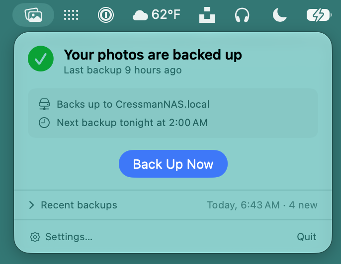

# Kept

[](https://github.com/cressmancm/KeptApp/actions/workflows/tests.yml)

**A passion project for backing up your Apple Photos library locally.**

## Why I made this

My parents gave me my first camera when I was 8, and my photo library has been my most prized possession ever since: close to 50,000 photos and videos, spanning more than three decades. Losing it would be devastating.

I'm all in on Apple Photos, and iCloud keeps my library synced and backed up. But if Apple ever made a mistake, like bungling an encryption key, I could lose access to all of it at once. I wanted a second copy that didn't depend on anyone's proprietary storage.

I looked at online backup services, but I already had a NAS with terabytes of free space, so I decided to build something myself. I found the incredible [osxphotos](https://github.com/RhetTbull/osxphotos), which handles the actual copying, so the plan was simple: wrap it in a menubar app that backs up my library on a schedule. It was also a chance to try my hand at agentic coding, so I built Kept with [Claude Code](https://claude.com/claude-code) as my partner, and I'm proud of what we made together.

Building Kept was a fun way to learn macOS development and agentic coding while solving a real problem of my own. I had a blast, and I hope you find it useful too.

Kept is free and privacy-focused, and it always will be. I hope it gives you the same peace of mind it's given me. You can see more of my work at [chipcressman.photo](https://chipcressman.photo).

<p align="center">
  
</p>

<p align="center">More of setup, settings, and notifications in the <a href="docs/screenshots/README.md">screenshots</a>.</p>

## What it does

- **Scheduled backups.** Choose nightly, weekly, or manual. At the scheduled time, Kept checks your whole library and copies only what's changed.
- **Privacy first.** Kept never tracks, analyzes, or reports on anything you do. I'm a privacy-minded developer, and I'd never build tracking into anything I make. The only thing Kept sends anywhere is a daily check with GitHub for a new release, and you can turn that off in Kept's settings.
- **Files you can always open.** Your backup is plain photos and videos in date folders, not a format only Kept can read. Keep it on a NAS, an external drive, or another disk.
- **Catches up on its own.** Asleep, offline, or on battery at backup time? Kept backs up as soon as it can, and retries before skipping a day.
- **Keeps what you delete.** Photos you delete stay in the backup for up to a year, for extra peace of mind.
- **Tells you when something needs attention.** If a backup fails, some photos don't copy, or backups stop, Kept lets you know in plain words, with what to do next.
- **Simple uninstall.** If you no longer need Kept, it removes itself cleanly and leaves your backup for you to decide what to do with.

## Download

Get **Kept-1.3.zip** from the [latest release](https://github.com/cressmancm/KeptApp/releases/latest), unzip it, drag Kept to Applications, and open it. It's signed and notarized by Apple, so it opens without warnings (see [Security and privacy](#security-and-privacy)). Kept's setup then walks you through turning on Full Disk Access in macOS and choosing a backup folder.

## Requirements

- Apple silicon, macOS 26 or later
- Full Disk Access for Kept, turned on in macOS System Settings → Privacy & Security, so Kept can read your Apple Photos library. Kept's setup walks you through it.
- Your photos stored on this Mac. Kept only backs up what's actually on your Mac, not what's only in iCloud. In Apple Photos, go to Settings → iCloud and turn on **Download Originals to this Mac** so every photo gets backed up (see [Limitations](#limitations)).
- Enough space to store your library, on your Mac, an external drive, or a network drive

## Security and privacy

- **Signed and notarized.** Kept is signed with my Apple Developer ID and notarized by Apple, which means Apple has scanned it for malicious software. macOS opens it without warnings.
- **No analytics, tracking, or reporting of any kind.** Kept collects nothing about you or your library, and reports nothing to anyone, including me.
- **Ad-free.** No ads, now or ever.
- **Your photos stay with you.** Kept copies your library only to the backup folder you choose. Nothing goes to a server or the cloud.
- **One network request.** Once a day, Kept asks GitHub whether there's a new release. It sends nothing about you or your library, and you can turn it off in Kept's settings.
- **Open source.** Every line of Kept is in this repository for anyone to read.

### Permissions

Kept needs only these macOS permissions, each to back up your library or tell you when something's wrong.

| macOS permission | Why Kept needs it |
| --- | --- |
| **Full Disk Access** | To read your Apple Photos library. Kept reads the library's files directly, which macOS only allows with Full Disk Access. Kept never changes, moves, or uploads anything in your library. |
| **Notifications** | To tell you when a backup fails or backups stop. Optional, but recommended. |

Kept also adds a login item and a once-a-day check, which macOS lists in System Settings → General → Login Items & Extensions. The daily check is how Kept warns you if backups stop, even when Kept isn't running.

## Limitations

- **Kept only backs up local copies.** If Apple Photos is set to **Optimize Mac Storage**, it keeps only some of your full-size photos on your Mac. The rest live in iCloud, where Kept can't back them up. I recommend switching Apple Photos to **Download Originals to this Mac** (Settings → iCloud) so Kept backs up your full library.
- **Shared photos aren't part of your library.** In Apple Photos, shared albums, shared collections, and Shared with You aren't technically in your library, so Apple Photos often doesn't keep them on your Mac, and Kept can't back them up. To make sure a shared photo is backed up, add it to your Apple Photos library.

## How it works

Kept is a SwiftUI menubar app. The copying itself is done by [osxphotos](https://github.com/RhetTbull/osxphotos), which ships inside Kept with its own Python, so there's nothing else to install. Kept takes care of everything around it:

- **When to back up.** The schedule, catching up after your Mac sleeps, retrying a failed backup, and never starting an unattended backup on battery.
- **Your network drive.** Reconnecting a NAS that's disconnected, even one that's stuck.
- **Deleted photos.** Setting them aside in the backup, then clearing them out after the time you chose.
- **Keeping you informed.** The menubar panel, setup, settings, and notifications.
- **Keeping your backup safe.** Kept won't use your home folder, a system or cloud folder, or a folder holding an Apple Photos library as the backup folder. Before every backup, it checks that the disk is still the one you chose. Inside the backup, Kept doesn't follow links: its own moves and deletions, and the folders and copies osxphotos makes there, refuse a link instead of going through it. It runs osxphotos in an isolated environment.

| Folder | What's in it |
|---|---|
| `app/Sources/Kept` | The app |
| `app/Tests/KeptTests` | The tests, including some that run Kept's real arguments through osxphotos |
| `app/Kept.xcodeproj` | The Xcode project |
| `app/*.sh` | Scripts to bundle Python, build, sign, and release |
| `app/python-requirements.lock` | Every bundled Python package, pinned with hashes |

Check out [ARCHITECTURE.md](ARCHITECTURE.md) for a map of the codebase.

## Building from source

Want to build Kept yourself? You'll need an Apple silicon Mac with Xcode 26 or later.

The quickest way is Xcode: open `app/Kept.xcodeproj` and run the **Kept** scheme. The first build downloads the Python that ships inside the app.

To build and install Kept the way a release is built, use the scripts:

```bash
cd app
./make-cert.sh       # once, if you don't have a Developer ID: a self-signed signing certificate
./bundle-python.sh   # once: the Python and osxphotos that ship inside the app
./build.sh           # builds, signs, installs to /Applications, and opens Kept
```

`build.sh` signs with your Developer ID if you have one, or with the self-signed "Kept Dev" certificate from `make-cert.sh` if you don't. Either way, the signature stays the same from build to build, so you only turn on Full Disk Access in macOS once. Run `make` in `app` to see every shortcut, including a debug build Xcode can attach to.

To run the tests:

```bash
cd app
swift test
```

[CONTRIBUTING.md](CONTRIBUTING.md) covers the rest: where Kept keeps its files, how to try the parts that are hard to reach, and signing your own builds. [RELEASING.md](RELEASING.md) walks through making a notarized release.

## Credits

- [osxphotos](https://github.com/RhetTbull/osxphotos) by Rhet Turnbull
- [python-build-standalone](https://github.com/astral-sh/python-build-standalone) by Astral
- Built with [Claude Code](https://claude.com/claude-code)

## License

Kept is open source under the MIT license (see [LICENSE](LICENSE)). osxphotos, Python, and the other bundled packages keep their own licenses, listed in `LICENSES.txt` inside the app.
