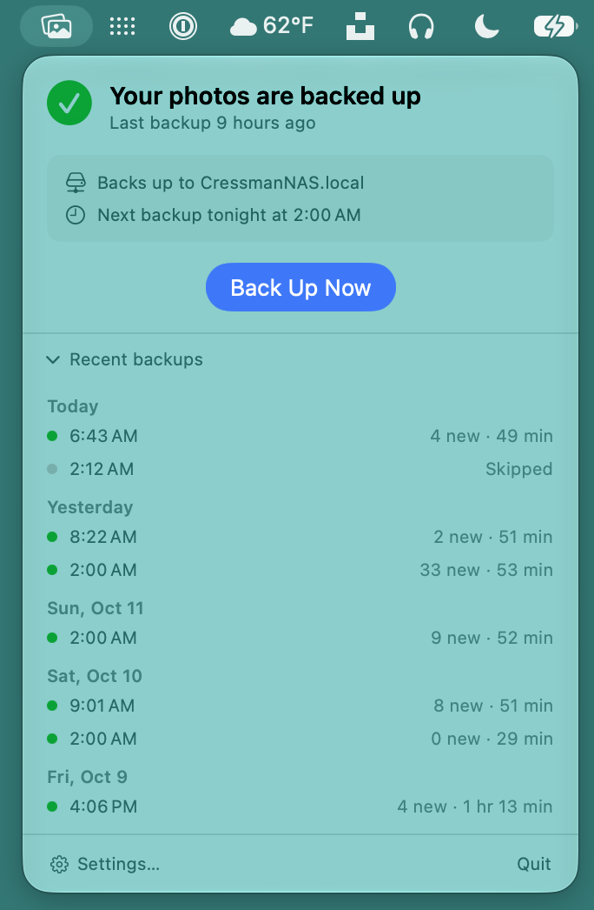
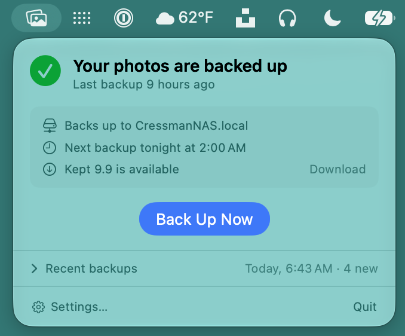
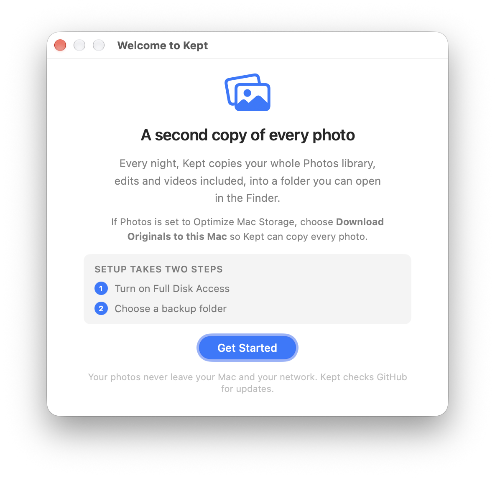
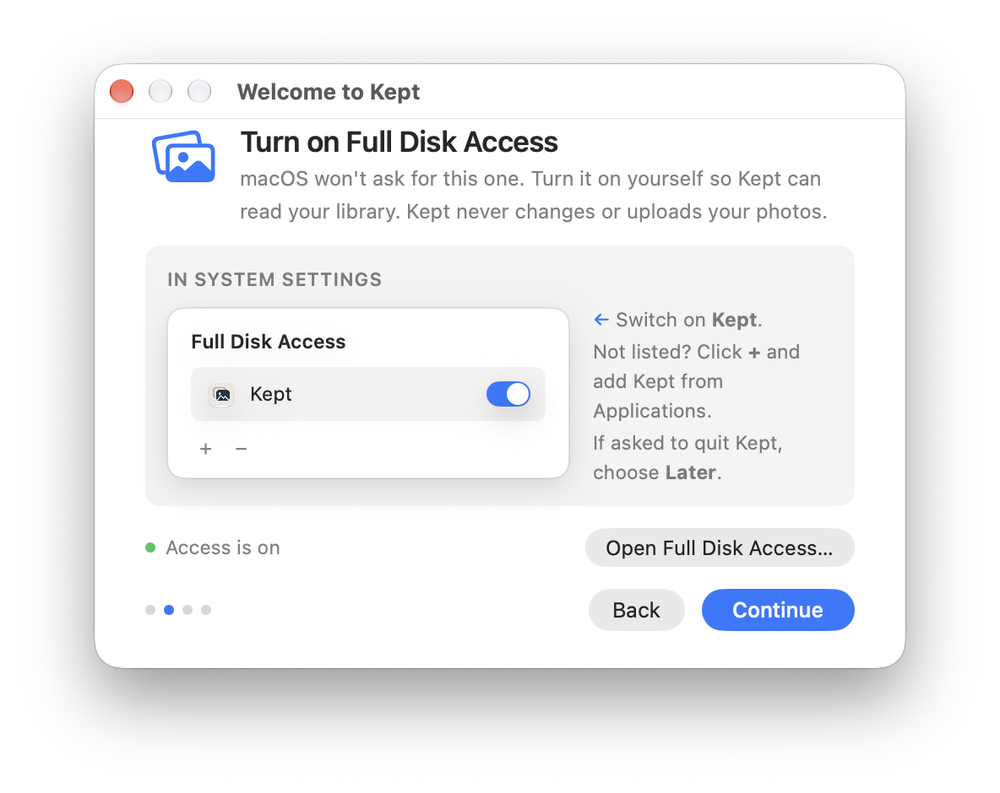
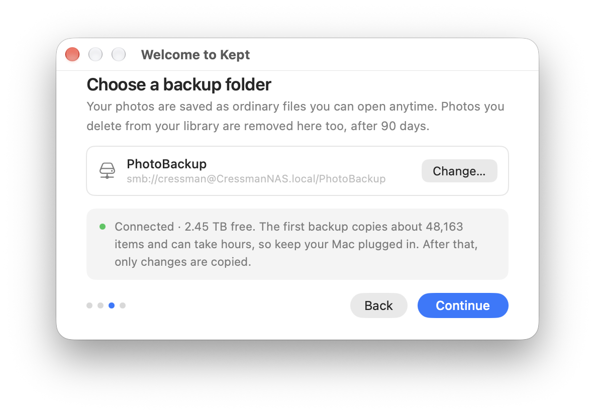
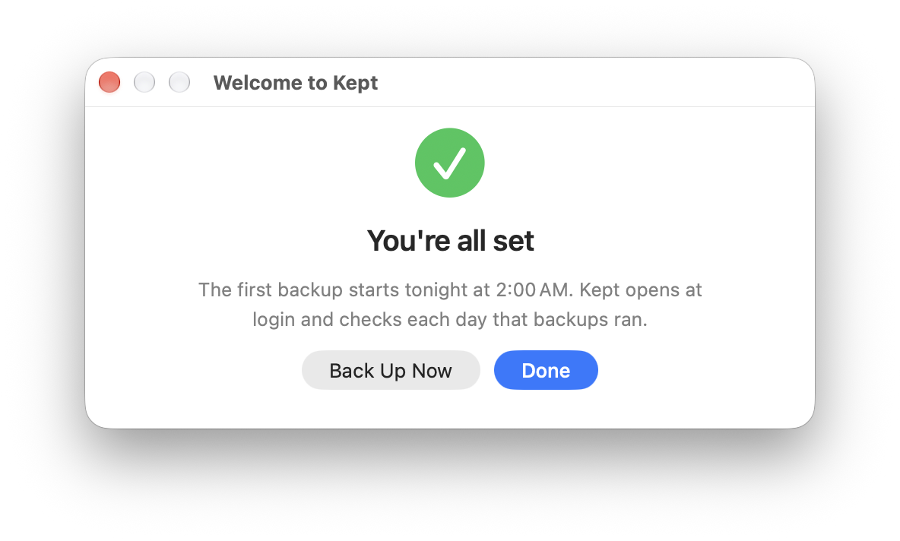
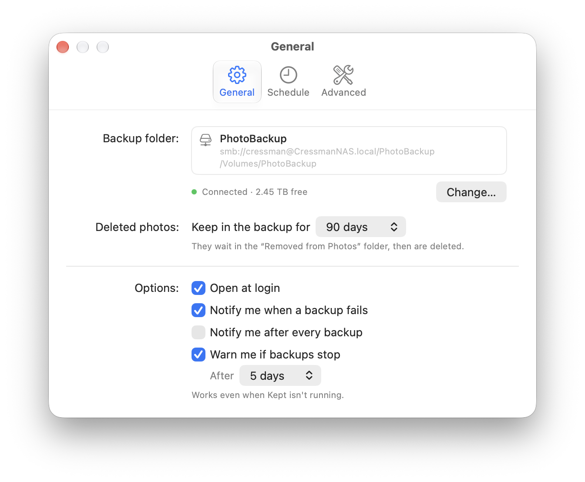
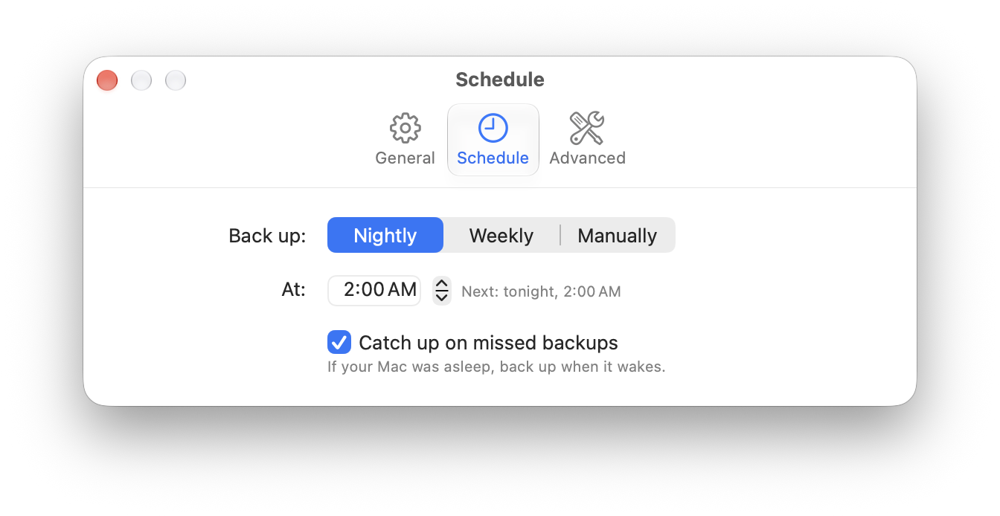
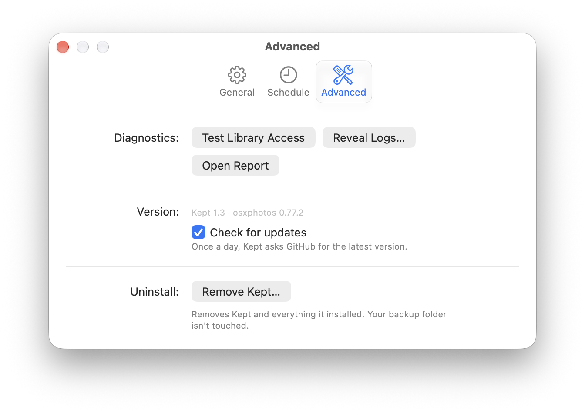
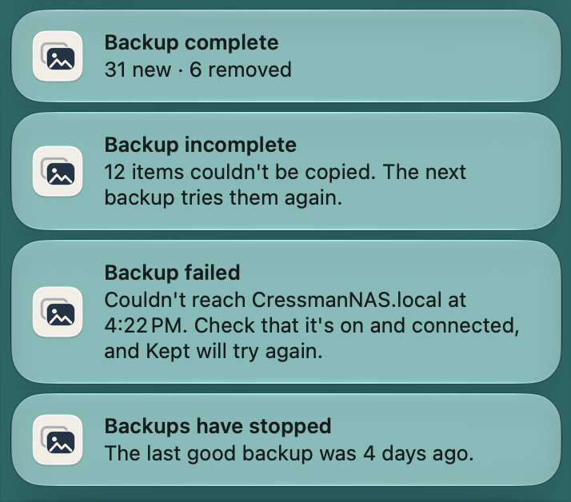

# Screenshots

Kept 1.3 on macOS 27.

## Menubar

Kept lives in the menubar. Click it to see whether your photos are backed up.

| Backed up | Recent backups | Update available |
| --- | --- | --- |
|  |  |  |

## Setup

Two steps: turn on Full Disk Access, then choose a backup folder.

| 1 · Welcome | 2 · Full Disk Access |
| --- | --- |
|  |  |

| 3 · Backup folder | 4 · Done |
| --- | --- |
|  |  |

## Settings

| General | Schedule | Advanced |
| --- | --- | --- |
|  |  |  |

## Notifications

